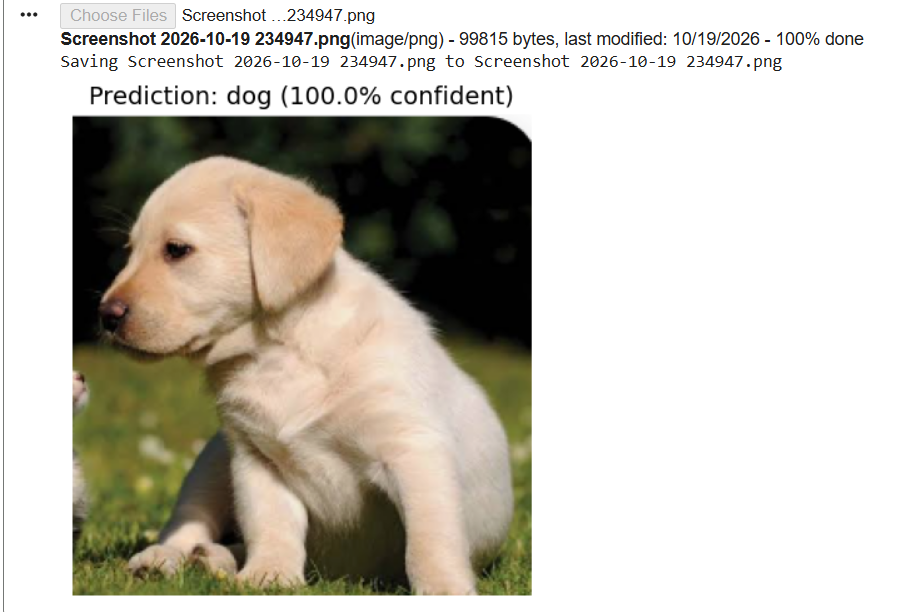
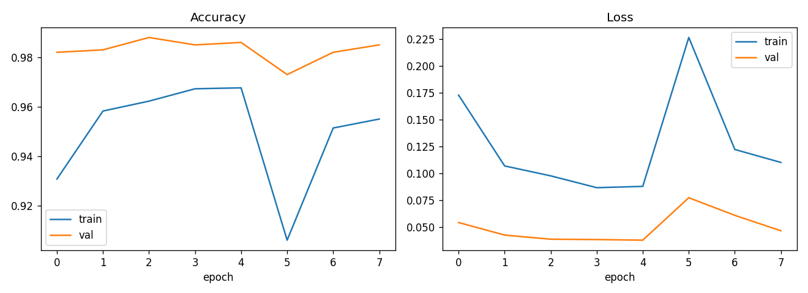
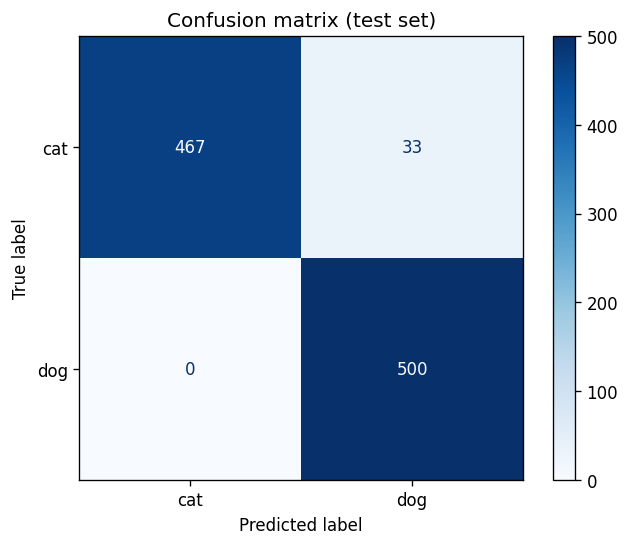

# Cat vs Dog Classifier (CNN, Transfer Learning)

A computer-vision project that classifies images as **cat** or **dog** using a
MobileNetV2 CNN pretrained on ImageNet and fine-tuned with TensorFlow/Keras.
Includes data download/cleaning, training, evaluation (confusion matrix), a
single-image predictor, and a Gradio web demo.

## Project structure
```
cat-vs-dog-cnn/
├── app.py                 # Gradio web demo
├── requirements.txt
├── src/
│   ├── config.py          # paths + hyperparameters
│   ├── download_data.py   # download, clean, split dataset
│   ├── data.py            # tf.data pipelines
│   ├── model.py           # MobileNetV2 + classifier head
│   ├── train.py           # 2-stage training (head, then fine-tune)
│   ├── evaluate.py        # test metrics + confusion matrix
│   └── predict.py         # predict one image
├── data/                  # created by download_data.py (git-ignored)
├── models/                # saved model (git-ignored)
└── outputs/               # training curves, confusion matrix
```

## Setup
Requires Python 3.10-3.12.
```bash
python -m venv venv
source venv/bin/activate        # Windows: venv\Scripts\activate
pip install -r requirements.txt
```

## Run
```bash
python -m src.download_data     # download + prepare dataset (5000 imgs/class)
python -m src.train             # train (~10-20 min on CPU, faster on GPU)
python -m src.evaluate          # test-set report + outputs/confusion_matrix.png
python -m src.predict my_pet.jpg
python app.py                   # launch the web demo
```
Use `python -m src.download_data --limit 0` for the full dataset (~25k images).
If the download link fails, get the dataset from Kaggle ("Dogs vs Cats" or
Microsoft's "Cats and Dogs") and run `python -m src.download_data --zip path/to/file.zip`
(the zip must contain a `PetImages/Cat` and `PetImages/Dog` folder).

## How it works
1. **Data:** images are cleaned (corrupt files removed, converted to RGB JPEG) and split 80/10/10 into train/val/test.
2. **Model:** MobileNetV2 (frozen) -> GlobalAveragePooling -> Dropout -> Dense(1, sigmoid). Data augmentation (flip, rotation, zoom) is applied during training.
3. **Training:** Stage 1 trains only the new head (lr 1e-3). Stage 2 unfreezes the top 30 MobileNetV2 layers and fine-tunes (lr 1e-5).
4. **Evaluation:** precision/recall/F1 and a confusion matrix on the untouched test split.

## Results



Evaluated on 1,000 held-out test images (500 cats, 500 dogs). The model catches every dog but mislabels about 6.6% of cats as dogs, so it leans slightly toward predicting "dog" when unsure.

| Metric | Value |
|---|---|
| Test accuracy | 96.7% |




## Ideas for extension
- Grad-CAM heatmaps to see what the model looks at
- Compare against a small CNN built from scratch
- Deploy the demo on Hugging Face Spaces

## License
MIT
